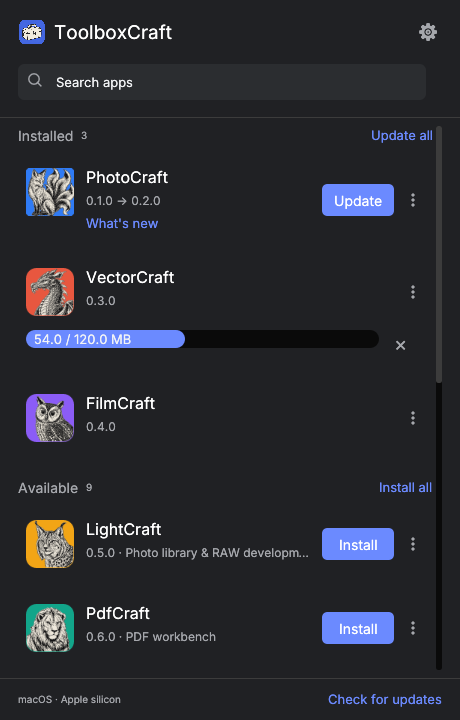

# ToolboxCraft

A native Rust desktop launcher for the twelve Artcraft apps. Install, open, update, and remove apps from one compact window. Downloads come from the official `storytold` GitHub repositories.

## Download

Get the latest build from [GitHub Releases](https://github.com/teunvanderploeg/ToolboxCraft/releases/latest).

Downloads cover Intel and Apple silicon Macs, Windows x64 and ARM64, and Linux x86_64 and ARM64.

| System | Download | Alternative |
| --- | --- | --- |
| macOS, Intel and Apple silicon | [Universal DMG](https://github.com/teunvanderploeg/ToolboxCraft/releases/download/v0.1.9/toolboxcraft-0.1.9-macos-universal.dmg) | App bundle ZIP |
| Windows x64 | [Per-user installer](https://github.com/teunvanderploeg/ToolboxCraft/releases/download/v0.1.9/toolboxcraft-0.1.9-windows-x64-setup.exe) | Portable ZIP |
| Windows ARM64 | [Per-user installer](https://github.com/teunvanderploeg/ToolboxCraft/releases/download/v0.1.9/toolboxcraft-0.1.9-windows-arm64-setup.exe) | Portable ZIP |
| Linux x86_64 | [AppImage](https://github.com/teunvanderploeg/ToolboxCraft/releases/download/v0.1.9/toolboxcraft-0.1.9-linux-x86_64.AppImage) | Tarball |
| Linux ARM64 | [AppImage](https://github.com/teunvanderploeg/ToolboxCraft/releases/download/v0.1.9/toolboxcraft-0.1.9-linux-aarch64.AppImage) | Tarball |

All alternatives and SHA-256 checksums are on the release page. On macOS, drag ToolboxCraft from the DMG into Applications. On Windows, run the installer or extract the portable ZIP and open `ToolboxCraft/toolboxcraft.exe`. On Linux, make the AppImage executable and run it. Quit an older copy before replacing it.

Version 0.1.7 enables automatic ToolboxCraft updates. Install it manually once when upgrading from 0.1.6 or earlier; those builds cannot check for ToolboxCraft updates. The initial 0.1.7 release uses ad-hoc signing on macOS and unsigned Windows builds. Subsequent releases using the platform-signing workflow require Developer ID signing and Apple notarization on macOS and trusted code signing on Windows; SmartScreen can still prompt while a new release builds reputation.



## Run

Requires Rust 1.91 or newer. The GUI uses egui/eframe 0.33 and OpenGL. It contains no webview, JavaScript, or Electron runtime. The application calls OS tools for native desktop integration.

```sh
cargo run -p toolboxcraft
```

On Debian/Ubuntu, install build dependencies first:

```sh
sudo apt-get install libxkbcommon-dev libxkbcommon-x11-dev libwayland-dev libgl1-mesa-dev libx11-dev libxrandr-dev libxi-dev
```

Linux desktop runs require the X11 keyboard library. On Debian/Ubuntu, install `libxkbcommon-x11-0` if the launcher reports that `libxkbcommon-x11.so` cannot be loaded.

Linux tray integration uses StatusNotifierItem over D-Bus. KDE and compatible desktops support it directly; GNOME needs an AppIndicator extension. When tray creation fails, closing the window exits normally. AppImages need FUSE; the app launcher uses extraction mode when `/dev/fuse` is unavailable.

```sh
cargo fmt --all --check
cargo clippy --workspace --all-targets --locked -- -D warnings
cargo test --workspace --locked
cargo build --workspace --locked
```

## What it manages

PhotoCraft, VectorCraft, FilmCraft, LightCraft, PdfCraft, EffectCraft, DesignCraft, WordCraft, SoundCraft, DeckCraft, CADCraft, and GridCraft. The catalog is bundled, while stable release versions and notes come from GitHub.

| System | Managed application location | Package |
| --- | --- | --- |
| macOS | `~/Applications/ToolboxCraft/<App>.app` | Official universal DMG |
| Windows | `%LOCALAPPDATA%/ToolboxCraft/ToolboxCraft/data/apps/<id>` | Official x64 or ARM64 portable ZIP |
| Linux | `${XDG_DATA_HOME:-~/.local/share}/toolboxcraft/apps/<id>` | Official x86_64 or ARM64 AppImage |

State, receipts, logs, download staging, and recovery records use the OS-standard directory returned by `directories::ProjectDirs`. On macOS it is `~/Library/Application Support/dev.ToolboxCraft.ToolboxCraft`.

Apps found in standard OS locations are marked External. You can open them or explicitly install a separate managed copy. ToolboxCraft never updates or uninstalls an external installation. External installations whose version cannot be read show Unknown.

Updates are enabled by default. ToolboxCraft checks at startup and every six hours while running, downloads up to two packages at once, and installs one app at a time. It waits for a running app to close, matching executable paths and the original `APPIMAGE` path for mounted Linux AppImages. Launch at login is optional and initially disabled. Automatic updates can be disabled globally or per app. Cancelled and failed updates require a manual retry.

Each package must match its release's `SHA256SUMS.txt`. macOS additionally requires Artcraft's publisher team `DJ6XS33FX8`, the expected bundle identifier, and the expected release version. Download quarantine is applied to installed macOS bundles. Checksums detect corruption; the app publishers remain the trust source for their releases.

Installers stage files before activation and keep a backup until the new installation and shortcut are recorded. Recovery runs at startup. Uninstalling removes only managed app files, receipts, and shortcuts; user documents and app preferences remain.

## Interface preview

Preview mode uses in-memory sample data and never starts the release checker or installer. It supports repeatable screenshots for visual inspection:

```sh
cargo run -p toolboxcraft -- --preview --screenshot /absolute/path/preview.png
cargo run -p toolboxcraft -- --preview --scale 2 --screenshot /absolute/path/preview-2x.png
cargo run -p toolboxcraft -- --preview --preview-settings --screenshot /absolute/path/settings.png
cargo run -p toolboxcraft -- --preview --preview-notes --screenshot /absolute/path/release-notes.png
```

Search app names or descriptions, use Cmd/Ctrl+F to focus search, click an installed app row to open it, use What's new or the overflow menu for full-page release notes, and use its overflow menu for automatic-update controls and uninstall. Uninstall removes the managed app immediately, without a confirmation. Your documents and app preferences stay. Closing the window keeps the launcher in the tray when a tray is available; use Quit to exit. On Windows, left-click or double-click the tray icon to restore and focus ToolboxCraft; right-click opens its menu. The restore path also handles minimized windows without waiting for the hidden UI to repaint. Launching ToolboxCraft again on Windows activates the existing window instead of starting another instance. Press Escape to return from Settings or release notes without losing your search.

## Package releases

The CI workflow runs formatting, Clippy, tests, and native builds on macOS, Windows, and Linux. The release workflow prepares universal macOS DMGs, Windows per-user NSIS installers and portable ZIPs, Linux AppImages and tarballs, updater ZIPs, and checksums. Pushing a `v<version>` tag builds and automatically publishes a complete GitHub release after every platform succeeds. The release requires a matching Ed25519 update-signing key, Developer ID signing and notarization on macOS, and trusted timestamped code signing on Windows. A manual workflow run produces reviewable artifacts without publishing; these test artifacts may be ad-hoc signed or unsigned.

Build both Rust executables before packaging. On macOS, combine x86_64 and aarch64 builds with `lipo` into a shared binary directory. On Windows install NSIS and add `makensis` to PATH. On Linux install `appimagetool`.

```sh
python3 packaging/package.py --platform macos-universal --version 0.1.9 --bin-dir target/universal/release
python3 packaging/manifest.py
```

Other platform keys are `windows-x64`, `windows-arm64`, `linux-x86_64`, and `linux-aarch64`. Package scripts require only standard Python libraries and the platform packaging tools. macOS packages without signing credentials are ad-hoc signed for local testing. Public tag releases reject missing distribution-signing credentials.

For signed releases, configure the CI signing certificate and notarization credentials described in [packaging/README.md](packaging/README.md). The Ed25519 release key authenticates self-updates. Apple and Windows certificates authenticate downloads to the operating system. Cross-platform runtime smoke tests must run on each target OS before distribution.

## ToolboxCraft self-updates

The official release repository and Ed25519 public key in `packaging/update-public-key.hex` are embedded in every build. Build-time environment variables can override the publisher for custom builds:

- `TOOLBOXCRAFT_RELEASE_REPO`: GitHub `owner/repository` for ToolboxCraft itself.
- `TOOLBOXCRAFT_UPDATE_PUBLIC_KEY`: hexadecimal 32-byte Ed25519 public key.

Self-updates are enabled by default, including when loading settings from older versions. Settings has a separate “Automatically update ToolboxCraft” switch. The launcher checks at startup and every six hours, downloads and verifies a newer stable release, waits for app operations to finish, and updates and restarts automatically. Disabling the switch keeps manual checks and “Update and restart” available. A failed installation requires a manual retry; checks run again on the next scheduled interval. Development binaries can check for releases but cannot replace themselves outside a supported installation layout.

The publisher uploads `update.json`, `update.json.sig`, and updater ZIPs to the matching `v<version>` GitHub release. `update.json.sig` is a base64 Ed25519 signature of the exact manifest bytes. The signed manifest maps platform keys to a ZIP filename, SHA-256, and byte length. The release workflow runs `packaging/manifest.py --require-signature --require-all-platforms`, verifies the signing key matches the embedded public key, and refuses incomplete packages before publication.

The running launcher verifies the manifest signature and package checksum, extracts into staging, and starts its existing local Rust updater helper. The helper waits for the launcher process to exit, stages the replacement beside the installation, swaps it with a backup, and restarts it. The replacement launcher removes the backup after its UI starts successfully. macOS updates must have a valid bundle signature and preserve the installed app's signing team when one exists. Authenticated ad-hoc builds can update to another authenticated ad-hoc build or to a Developer ID build.

Self-update is supported for packaged `.app` bundles, Linux AppImages, and installed or portable folders named `ToolboxCraft`. Development binaries and arbitrary portable folder names report an actionable error. If a replacement cannot start, recover the adjacent `.toolboxcraft-backup` copy. A failed helper leaves the working installation or its backup intact.

## Diagnostics and boundaries

Logs rotate daily under the data directory's `logs` folder. Set `RUST_LOG=debug` for more detail. GitHub failures retain cached releases and installed apps. Release details indicate cached metadata older than six hours. Checks and downloads use system proxy settings through reqwest.

For Windows exit problems, see the [shutdown regression checks](docs/windows-shutdown.md) for reproduction steps and shutdown log markers.

This first release does not include parallel versions, prerelease channels, remote management, document indexing, or user-selected rollback. Platform integration code exists for all three systems; native runtime validation must be performed on the respective OS.

ToolboxCraft is an independent project. It is not affiliated with JetBrains or Artcraft. See [ATTRIBUTION.md](ATTRIBUTION.md) for bundled artwork and fonts.

## macOS signature regression check

The installer copies the bundle out of its DMG without Finder resource metadata, verifies its nested code against the Artcraft publisher, then applies download quarantine. To exercise the full staging path with a checksum-verified official WordCraft DMG:

```sh
TOOLBOXCRAFT_TEST_DMG=/absolute/path/wordcraft-macos-universal.dmg \
TOOLBOXCRAFT_TEST_VERSION=0.6.1 \
cargo test -p toolboxcraft-platform official_wordcraft_dmg -- --ignored
```

The test uses a temporary directory and preserves installed apps. Set the version to match the downloaded release.
